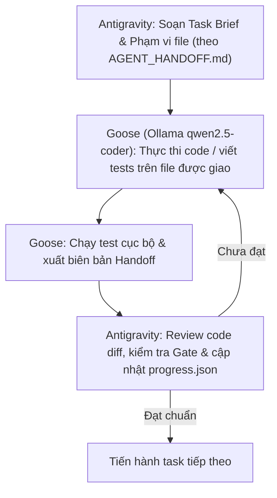

# Kế hoạch phối hợp Antigravity & Goose (Ollama) hoàn thiện Topica

> **Mục tiêu**: Tối ưu hóa hiệu năng và tài nguyên bằng cách kết hợp:
> - **Antigravity (Lead Orchestrator / Cloud AI)**: Đóng vai trò Kiến trúc sư trưởng, người kiểm duyệt (Gatekeeper), điều phối `progress.json` và nghiệm thu các cổng G0–G9.
> - **Goose + Ollama (Local Specialist Worker / Local GPU)**: Đóng vai trò Kỹ sư thực thi cục bộ, xử lý các tác vụ code độc lập, viết test, dọn dẹp CSS/HTML và script tiện ích mà không tốn chi phí token đám mây.

---

## 1. Hiện trạng phần cứng & Mô hình Ollama trên máy

Hệ thống đã nhận diện sẵn các công cụ:
- **Goose CLI**: `1.48.0` (đã cấu hình sẵn provider `ollama`, endpoint `http://localhost:11434`).
- **Ollama**: Đang chạy trên GPU, với các mô hình đã tải sẵn:
  1. `qwen2.5-coder:14b-50k` (9.0 GB): **Tối ưu nhất cho Coding & Testing** (TypeScript, Next.js, Tailwind, Vitest).
  2. `smtek/Qwen3.8-27B:Q3_K_XL-16gb` (13 GB): **Tối ưu cho Tiếng Việt & Rà soát nội dung** (Content register, chính sách học thuật).
  3. `gpt-oss:20b` (13 GB): Mô hình tổng quát.
  4. `qwen3.5:4b` (3.3 GB): Mô hình siêu nhẹ cho các tác vụ kiểm tra nhanh.

---

## 2. Ma trận phân chia trách nhiệm (Responsibility Matrix)

| Gói việc | Nhiệm vụ | Vai trò chính | Lý do phân công |
| :--- | :--- | :---: | :--- |
| **R00** | Khôi phục baseline & sự thật audit | **Antigravity** | Đòi hỏi phân tích toàn diện, đối chiếu đa chiều các báo cáo lịch sử. |
| **R01** | Cô lập DB test, env contract & stub notification | **Antigravity + Goose** | **Antigravity** thiết kế env contract; **Goose (`qwen2.5-coder`)** viết mock Telegram & helper temp DB. |
| **R02** | Script backup & restore SQLite an toàn | **Goose** | Viết script SQLite checkpoint & verify restore theo đặc tả kỹ thuật độc lập. |
| **R03** | Sổ nội dung chính thức & tổng hợp thắc mắc | **Goose (`Qwen-27B`)** | Quét dữ liệu `data/*.ts` hiện có, tạo `content_register.csv` và bóc tách các điểm xung đột. |
| **R04** | Đồng bộ danh tính, contact & portal link | **Goose** | Refactor các component tĩnh (`Header`, `Footer`, `Campuses`, `FloatingActions`) dùng chung một config data. |
| **R05** | Hợp đồng chương trình & học phí | **Antigravity** | Phức tạp về nghiệp vụ tài chính, đối tượng áp dụng và công thức tính. |
| **R06** | Làm sạch HTML entities & metadata | **Goose** | Tác vụ xử lý chuỗi mẫu (`&#038;` -> `&`, plain-text excerpt) trong `lib/cms/html.ts`. |
| **R07** | Route map, IA & hành trình người học | **Antigravity** | Quyết định cấu trúc điều hướng toàn site, catch-all routing và canonical SEO. |
| **R08** | Concept mỹ thuật & prototype | **Antigravity** | Định hướng thẩm mỹ 2 tông Navy và bố cục trải nghiệm học thuật. |
| **R09** | Hợp nhất Design Tokens CSS | **Goose** | Rà soát và gộp các biến trùng lặp trong `tokens.css`, `theme.css`, `design-tokens.css`. |
| **R10** | Mobile drawer, focus, keyboard & sticky | **Goose** | Sửa style CSS tương phản nút CTA mobile và logic phím Escape/focus trap. |
| **R11–R14** | Thiết kế & triển khai các trang công khai (T01–T12) | **Antigravity** phối hợp | Antigravity định hình layout chính; Goose hỗ trợ code các component con và responsive. |
| **R15** | Form tư vấn & Idempotency API | **Goose + Antigravity** | **Goose** viết logic chống spam/idempotency in-memory; **Antigravity** kiểm tra luồng consent & security. |
| **R16** | CMS Data Model & Migration an toàn | **Antigravity** | Thiết kế schema SQLite, revisioning và logic transaction rollback. |
| **R17–R19** | CMS Workflow, Lịch công bố & UI Admin | **Antigravity** | Nghiệp vụ biên tập viên, quyền RBAC và draft mode của Next.js. |
| **R20** | Thử nghiệm người dùng thật | **Con người (Topica)** | Cần người dùng thật thử nghiệm, ghi log; AI không được làm giả. |
| **R21** | Tích hợp dữ liệu & loại bỏ fallback ảo | **Antigravity** | Kiểm soát luồng dữ liệu end-to-end, ngăn chặn lọt draft ra public. |
| **R22** | Sửa script kiểm tra tự động (Axe, Links, Lighthouse) | **Goose** | Viết lại `scripts/test-links.ts` (crawl thực), gỡ hardcode score trong `scripts/test-lighthouse.ts`. |
| **R23–R24** | Audit UI/A11y thực tế & Nghiệm thu RC | **Antigravity** | Chấm rubric thiết kế 20 điểm, soát 10 cổng nghiệm thu G0–G9. |
| **R25–R29** | Staging, Rollback, Bàn giao & Vận hành 30 ngày | **Antigravity** | Thao tác DevOps, runbook và giám sát sản phẩm sau release. |

---

## 3. Quy trình phối hợp 4 bước (Orchestration Loop)



1. **Bước 1 (Giao việc - Antigravity)**: Chuẩn bị prompt ngắn gọn theo đúng mẫu trong `AGENT_HANDOFF.md`, chỉ định rõ: Task ID, file được sửa, tiêu chí pass.
2. **Bước 2 (Thực thi - Goose + Ollama)**: Chạy Goose trong terminal với model `qwen2.5-coder:14b-50k` để đọc source và chỉnh sửa.
3. **Bước 3 (Bàn giao - Goose)**: Goose xuất kết quả trước/sau, lệnh test đã chạy và exit code.
4. **Bước 4 (Nghiệm thu - Antigravity)**: Antigravity kiểm tra không có xung đột, không phá vỡ quy tắc bảo vệ DB, rồi đánh dấu trạng thái trong `progress.json`.

---

## 4. Các gói việc Goose có thể nhận làm ngay lập tức

### 🎯 Gói G1 (Hỗ trợ Task R06) — Dọn dẹp HTML Entities & Metadata
- **Mục tiêu**: Xử lý triệt để lỗi hiển thị `&#038;` trên tab title, làm sạch excerpt.
- **File phạm vi**: `lib/cms/html.ts`, `__tests__/cms/html.test.ts`.
- **Lệnh chạy Goose**:
  ```bash
  goose session --model qwen2.5-coder:14b-50k
  ```
- **Prompt giao cho Goose**:
  > *"Đọc file `lib/cms/html.ts`. Hãy hoàn thiện hàm `decodeHtmlEntities` và `sanitizePlainTextExcerpt` để chuyển đổi đúng các entity tiếng Việt và ký tự đặc biệt như `&#038;` thành `&`, bỏ các shortcode HTML thừa nhưng vẫn đảm bảo chống XSS. Sau đó viết bộ test đầy đủ trong `__tests__/cms/html.test.ts` và chạy test xác nhận pass."*

### 🎯 Gói G2 (Hỗ trợ Task R22) — Viết lại Script Link Crawler thật
- **Mục tiêu**: Thay thế script `scripts/test-links.ts` cũ (chỉ kiểm tra bề mặt) bằng crawler kiểm tra redirect đích cuối và kiểm tra định dạng file tải về.
- **File phạm vi**: `scripts/test-links.ts`.
- **Prompt giao cho Goose**:
  > *"Sửa lại `scripts/test-links.ts`: Thay vì chỉ check HTTP 200/3xx tĩnh, hãy crawl tất cả thẻ `<a>` và `<button>` trong các route chính, follow redirect đến đích cuối, kiểm tra xem link tải file có đúng MIME type không, ghi nhận rõ mã lỗi mạng nếu có thay vì tự biến thành HTTP 500."*

### 🎯 Gói G3 (Hỗ trợ Task R09) — Rà soát & Hợp nhất Token CSS
- **Mục tiêu**: Hợp nhất các biến CSS bị phân tán ở `tokens.css`, `app/theme.css` và `app/design-tokens.css` về một chuẩn thống nhất mang 2 sắc độ Navy (`#00264D` và `#16466B`).
- **File phạm vi**: `tokens.css`, `app/theme.css`, `app/design-tokens.css`.
- **Prompt giao cho Goose**:
  > *"Đối chiếu 3 file CSS chứa token. Tìm các biến màu bị trùng lặp hoặc mâu thuẫn (đặc biệt là biến navy và ink). Chuẩn hóa chúng theo bảng màu trong `docs/agent-execution/DESIGN_UX_SPEC.md` mà không làm hỏng giao diện Admin."*
