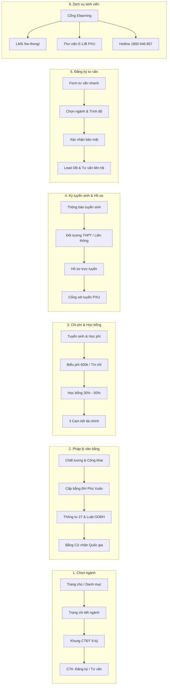

# BẢN ĐỒ ĐIỀU HƯỚNG & 6 HÀNH TRÌNH QUYẾT ĐỊNH CỦA NGƯỜI HỌC (TASK R07)

> **Mục tiêu**: Chuẩn hóa toàn bộ URL, Canonical, Redirect và 6 hành trình cốt lõi theo `IMPLEMENTATION_BACKLOG.md` (R07) và `DESIGN_UX_SPEC.md`.

---

## 🗺️ 1. NGUYÊN TẮC KIẾN TRÚC ĐIỀU HƯỚNG (IA PRINCIPLES)

1. **Zero Dead End (Không ngõ cụt)**:
   - Mọi trang đều có tiêu đề, breadcrumbs rõ ràng và khối "Bước tiếp theo / CTA" dẫn đến hành động cụ thể (Xem học phí, Nhận tư vấn, hoặc Đăng ký xét tuyển).
   - Không có liên kết placeholder `#` hoặc link rỗng trong navigation và nội dung trang.

2. **Canonical Thống nhất**:
   - 5 chương trình cử nhân trực tuyến có Canonical tại cấp gốc: `https://topicauni.edu.vn/[slug]/`.
   - Các URL truy cập dạng phân cấp `https://topicauni.edu.vn/nganh-dao-tao/[slug]` sẽ tự động chuyển hướng vĩnh viễn (308) về canonical gốc tương ứng.

3. **Chuyển hướng Legacy đúng chủ đề**:
   - Giữ nguyên giá trị SEO của các liên kết WordPress cũ bằng cách redirect chính xác về đúng trang đích thay vì dồn mọi trang về trang chủ `/`.
   - Các URL rút gọn (`/quan-tri-kinh-doanh`, `/cntt`, `/tieng-anh`, `/tieng-trung`, `/du-lich-lu-hanh`) chuyển hướng 308 về đúng trang chi tiết ngành.

4. **Xử lý 404 Thực tế & Chân thực (True 404)**:
   - Khi đường dẫn không tồn tại trong CMS, route static hay alias: Trả về mã HTTP 404 thật (`notFound()`).
   - Giao diện 404 cung cấp ô tìm kiếm tức thì, danh sách 5 ngành đào tạo cử nhân, hotline tuyển sinh miễn cước `1800 646 857` và câu hỏi thường gặp FAQ để người học tiếp tục hành trình.
   - Các đường dẫn rác từ WooCommerce cũ (`/cart`, `/checkout`, `/shop`, `/my-account`, `/classic-shop`) bị chặn và trả về 404 ngay lập tức, không lọt vào sitemap hay search index.

---

## 🧭 2. CHI TIẾT 6 HÀNH TRÌNH QUYẾT ĐỊNH (LEARNER DECISION JOURNEYS)

---

## 📋 3. DANH SÁCH URL KIỂM THỬ QA (QA URL AUDIT MATRIX)

| STT | URL Kiểm thử                            | Loại           | Điểm đến mong muốn                      | Tiêu chí nghiệm thu                                 |
| :-: | --------------------------------------- | -------------- | --------------------------------------- | --------------------------------------------------- |
|  1  | `/`                                     | Core           | Trang chủ                               | 200 OK, hiển thị 5 ngành, đối tác ĐH Phú Xuân       |
|  2  | `/nganh-dao-tao/`                       | Core           | Danh mục 5 ngành                        | 200 OK, thông tin mã ngành, link tới 5 ngành        |
|  3  | `/quan-tri-kinh-doanh-marketing/`       | Program        | Chi tiết QTKD                           | 200 OK, canonical đúng, facts 126 tín chỉ, bằng PXU |
|  4  | `/quan-tri-dich-vu-du-lich-va-lu-hanh/` | Program        | Chi tiết Du lịch                        | 200 OK, canonical đúng, facts 126 tín chỉ, bằng PXU |
|  5  | `/cong-nghe-thong-tin/`                 | Program        | Chi tiết CNTT                           | 200 OK, canonical đúng, facts 126 tín chỉ, bằng PXU |
|  6  | `/ngon-ngu-anh/`                        | Program        | Chi tiết Tiếng Anh                      | 200 OK, canonical đúng, facts 126 tín chỉ, bằng PXU |
|  7  | `/ngon-ngu-trung-quoc/`                 | Program        | Chi tiết Tiếng Trung                    | 200 OK, canonical đúng, facts 126 tín chỉ, bằng PXU |
|  8  | `/quan-tri-kinh-doanh`                  | Legacy Alias   | `/quan-tri-kinh-doanh-marketing/`       | 308 Permanent Redirect, không rơi vào 404           |
|  9  | `/cntt`                                 | Legacy Alias   | `/cong-nghe-thong-tin/`                 | 308 Permanent Redirect, không rơi vào 404           |
| 10  | `/tieng-anh`                            | Legacy Alias   | `/ngon-ngu-anh/`                        | 308 Permanent Redirect, không rơi vào 404           |
| 11  | `/tieng-trung`                          | Legacy Alias   | `/ngon-ngu-trung-quoc/`                 | 308 Permanent Redirect, không rơi vào 404           |
| 12  | `/du-lich-lu-hanh`                      | Legacy Alias   | `/quan-tri-dich-vu-du-lich-va-lu-hanh/` | 308 Permanent Redirect, không rơi vào 404           |
| 13  | `/nganh-dao-tao/cong-nghe-thong-tin`    | Nested Path    | `/cong-nghe-thong-tin/`                 | 308 Permanent Redirect về canonical root            |
| 14  | `/tuyen-sinh/hoc-phi-hoc-bong/`         | Core           | TuitionHub                              | 200 OK, biểu phí 600k/TC, học bổng 2026             |
| 15  | `/hoc-phi`                              | Legacy Alias   | `/tuyen-sinh/hoc-phi-hoc-bong/`         | 308 Permanent Redirect                              |
| 16  | `/he-thong/`                            | Service Portal | Cổng Elearning                          | 200 OK, điều hướng vào LMS, không dead end          |
| 17  | `/lien-he/`                             | Contact        | Trang liên hệ                           | 200 OK, hotline 1800 646 857, email tuyển sinh      |
| 18  | `/nhung-cau-hoi-thuong-gap/`            | FAQ            | Trang hỏi đáp                           | 200 OK, giải đáp học online, thi cử, bằng cấp       |
| 19  | `/cart`                                 | WooCommerce cũ | Blocked                                 | 404 Not Found, không lộ nội dung shop               |
| 20  | `/khong-ton-tai-abc-xyz/`               | Invalid Route  | 404 Handler                             | 404 Not Found, có thanh tìm kiếm và gợi ý 5 ngành   |
