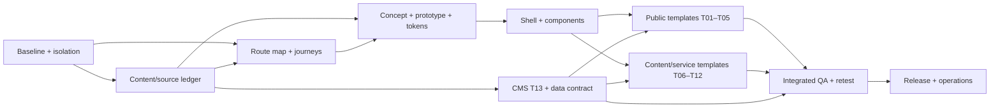

# Kế hoạch triển khai trải nghiệm website Topica — AI-agent handoff

**Trạng thái:** kế hoạch đề xuất; chưa phải báo cáo đã sửa giao diện hoặc đã nghiệm thu.  
**Mục tiêu:** giúp nhiều AI agent có thể tiếp nối có kiểm soát, tạo website Topica giàu bản sắc, dễ hiểu, đáng tin, responsive và đủ ấn tượng để người học nhớ tới — đồng thời không tự bịa dữ liệu nghiệp vụ hoặc tuyên bố chất lượng thiếu bằng chứng.

## 1. Đọc trước khi nhận task

Đọc theo thứ tự dưới đây; yêu cầu mới nhất của người dùng và `AGENTS.md` tại repo/thư mục đang sửa luôn có ưu tiên cao nhất:

1. [`AGENTS.md`](../../AGENTS.md) và [`README.md`](README.md) — quy tắc repo, an toàn, thứ tự thực thi.
2. [`DESIGN_UX_SPEC.md`](DESIGN_UX_SPEC.md) — nguyên tắc nhận diện, nội dung, 13 template và hành trình.
3. Task tương ứng trong [`IMPLEMENTATION_BACKLOG.md`](IMPLEMENTATION_BACKLOG.md) — nguồn phạm vi kỹ thuật R00–R29.
4. [`HYPER_UI_REMEDIATION_PLAN.md`](HYPER_UI_REMEDIATION_PLAN.md) — finding HUI-01–HUI-09, phân chia HU-01–HU-07 và hướng thiết kế Hyper UI đã được điều chỉnh theo Topica.
5. [`ACCEPTANCE_AND_EVIDENCE.md`](ACCEPTANCE_AND_EVIDENCE.md) — ma trận test, accessibility, performance, SEO, evidence và release gate.
6. [`AGENT_HANDOFF.md`](AGENT_HANDOFF.md) — ownership, prompt, mẫu bàn giao, blocker và đầu vào cần Topica xác nhận.
7. `progress.json`, content register, evidence và defect register hiện hành — xác minh trạng thái thực trước khi lập thứ tự.

Tên file/route bên dưới là inventory hiện biết hoặc vị trí định hướng. Trước khi sửa phải kiểm tra source, callers, route/data mapping và Git status. Không tạo route trùng hoặc cho rằng tên component đồng nghĩa với hành vi đã xác minh.

## 2. Định nghĩa mục tiêu “WOW” cho Topica

“WOW” ở đây là trải nghiệm có điểm nhìn và tiếng nói riêng: trang đầu tiên tạo cảm giác học thuật hiện đại, có con người thật khi có asset được duyệt; người học nhìn ra ngành, bằng chứng, chi phí và bước tiếp theo; từng mẫu trang có nhịp biên tập phù hợp nội dung; typography, khoảng thở, crop ảnh, trạng thái tương tác và chi tiết mobile được hoàn thiện đồng đều.

WOW không được đánh đổi sự thật hoặc khả năng sử dụng. Không bịa số liệu/claim, logo đối tác, lời chứng thực, giá, học bổng hay tình trạng kỳ tuyển sinh. Không dùng hiệu ứng neon/aurora/glass/3D chỉ vì skill có ví dụ; không áp một hero + ba card lên mọi template; không thêm animation bắt buộc, parallax hoặc hover-only interaction. Nếu thiếu ảnh có quyền sử dụng, chọn bố cục typographic/editorial có chủ ý thay cho ảnh giả hoặc ảnh không rõ nguồn.

### Hướng thẩm mỹ và nguyên tắc quyết định

- **Bản sắc:** học thuật, hiện đại, gần gũi, minh bạch; navy `#00264D` và `#16466B` theo spec hiện tại, gold `#B78744` tiết chế. Đây là token đề xuất trong spec, không phải kết quả xác minh logo/đối chiếu đối tác.
- **Typography:** giữ font đã có trong app (Be Vietnam Pro và Lora) cho tới khi có quyết định thiết kế có lý do. Dùng font display có vai trò, không thay tất cả font hoặc thêm tải font chỉ để tạo khác biệt. Không dùng italic cho heading chính.
- **Cấu trúc:** chọn macrostructure theo nhiệm vụ từng template. Trang chủ có thể dùng Narrative Workflow đã nêu trong Hyper UI plan; trang ngành là long document/fact sheet; tin tức/bài viết là editorial; CMS là workbench/operate. Chỉ dùng Bento khi nhóm thông tin thực sự độc lập và vẫn có thứ tự đọc.
- **Điểm nhấn:** tối đa 1–2 visual focus chính trên mỗi màn hình/viewport; hiệu ứng chỉ hỗ trợ tập trung, giải thích trạng thái hoặc phản hồi thao tác. Không để nhiều hiệu ứng tranh nhau với CTA/nội dung học thuật.
- **Motion:** mặc định nhẹ, ngắn và không che nội dung; mọi hiệu ứng có phương án `prefers-reduced-motion`. Không chọn Framer Motion/Tailwind/Shadcn chỉ vì Hyper UI gợi ý; giữ stack, component và conventions đang có, trừ khi task chứng minh cần thay đổi.
- **Hình ảnh:** mỗi asset public phải có nguồn, quyền, alt/caption, phạm vi sử dụng và reviewer trong register/manifest. Lưu ý crop focal point cho desktop/mobile. Không dùng ảnh logo/đối tác làm bằng chứng quan hệ nếu chưa xác nhận.
- **Copy:** một hành động chính rõ ở mỗi vùng; nhãn mô tả đúng đích và chức năng. CTA tuyển sinh, tư vấn và tra cứu hồ sơ là các hành động khác nhau.

### Visual quality bar trước khi agent bàn giao

Agent phải trả lời bằng bằng chứng trực quan, không chỉ mô tả:

1. **Nhận diện:** nhìn thấy chủ đích Topica qua hệ màu/type/ảnh/giọng nội dung; không thể thay logo là thành website bất kỳ.
2. **Hierarchy:** tiêu đề, thông tin quyết định, nội dung phụ và action có cấp bậc rõ ở desktop và mobile; không có nhiều “hero” cạnh tranh.
3. **Nhịp điệu:** có tương phản giữa vùng ảnh, vùng chữ, dữ liệu và khoảng nghỉ; không lặp card/section cùng hình thức cho đủ chiều dài.
4. **Tin cậy:** claim trọng yếu có nguồn/hiệu lực hoặc được ẩn/ghi trạng thái trung tính; không có dữ liệu giả dưới dạng placeholder public.
5. **Hoàn thiện:** tiếng Việt không vỡ dòng/cắt dấu; ảnh, tải chậm, thiếu ảnh, tên dài, trạng thái rỗng/lỗi và sticky/focus đều được xử lý.
6. **Khả dụng:** thao tác bàn phím/touch có phản hồi; reduced motion và focus nhìn thấy; ở viewport nhỏ không phải cuộn ngang để hiểu dữ liệu cốt lõi.

Dùng rubric 0–2 của `DESIGN_UX_SPEC.md`, ghi lý do cho từng mục và lưu screenshot thật. Điểm chuyên gia không phải user research, conversion rate, Lighthouse hay chứng nhận WCAG.

## 3. Bản đồ 13 template, route và đầu ra

| ID  | Template / route hiện biết (xác minh trong R07)                        | Backlog / source hiện hữu cần đọc trước khi sửa                                                             | Mục tiêu và cấu trúc trải nghiệm                                                                                                                                                                                                                                 | States, nguồn cần xác nhận và evidence                                                                                                                                |
| --- | ---------------------------------------------------------------------- | ----------------------------------------------------------------------------------------------------------- | ---------------------------------------------------------------------------------------------------------------------------------------------------------------------------------------------------------------------------------------------------------------- | --------------------------------------------------------------------------------------------------------------------------------------------------------------------- |
| T01 | `/`; `app/(main)/page.tsx`, `components/sections/*`                    | R11, R15, R21; `HeroSection`, `CurrentAdmissions`, `ProgramsSection`, trust/experience/news/form components | Hiểu Topica, khám phá 5 ngành, xem bằng chứng và biết bước tiếp theo. Narrative Workflow: hero → kỳ hiện hành → ngành → bằng chứng → trải nghiệm → lối sang học phí/lộ trình → câu chuyện → tin → tư vấn; ảnh người học thật đã duyệt, không form dài trong hero | Có/không có kỳ, claim/asset/story thiếu, menu, CTA/form; desktop/mobile; kiểm thứ tự section, anchor, CTA destination và chỉ một form                                 |
| T02 | `/nganh-dao-tao`                                                       | R12, R21; `NavigationHub`/program list, `data/programs.ts` (xác định source of truth thực tế)               | So sánh đủ 5 ngành, tách tên ngành/chuyên ngành. Index dễ quét, nhóm có nghĩa, nhịp bố cục đa dạng thay vì 5 card đồng dạng                                                                                                                                      | Đủ 5 ngành đã duyệt, tên dài, thiếu ảnh; link T03/canonical/breadcrumb/CTA đúng; cùng ID/facts xuyên consumer                                                         |
| T03 | Program slugs trong `app/(main)/[...slug]/page.tsx`; `ProgramPageView` | R12, R05, R06, R21; `ProgramHero`, `ProgramQuickFacts`, curriculum/roadmap/outcomes/FAQ/`ProgramStickyBar`  | Kiểm chứng facts, cách học/thi, chương trình, bằng cấp, chi phí, điều kiện. Editorial long document + fact sheet; key facts sớm, mục lục anchor thật, curriculum theo chiều sâu                                                                                  | Đủ 5 ngành, ngành/tên dài và thiếu dữ liệu; anchors/sticky; bằng cấp/học phí/curriculum cùng contract; mobile không bị che                                            |
| T04 | `/tuyen-sinh`                                                          | R13, R05, R06, R18, R21; `AdmissionHub`, `CurrentAdmissions`, `AdmissionAnnouncementCard`, timeline/docs    | Xác định đối tượng, kỳ, hạn, hồ sơ và bước nộp. Tách kỳ tuyển sinh khỏi quy trình nhập học; status/date/source và tài liệu theo ngữ cảnh                                                                                                                         | Kỳ tương lai/đang mở/đã đóng/không có kỳ; link/file thật; date boundary/timezone/cache và đúng CTA                                                                    |
| T05 | `/tuyen-sinh/hoc-phi-hoc-bong`; `/hoc-phi` cần xác minh redirect       | R13, R05, R06, R16, R18, R21; `TuitionHub`, `DocumentCard`, pricing data/services                           | So sánh chi phí theo chương trình/khóa/đối tượng và hiểu giả định. Trang quyết định dạng pricing/specification; mobile card/bảng dễ đối chiếu, nêu tổng/đơn giá/khoản chưa gồm/source                                                                            | Policy thiếu/chồng lấn, đối tượng khác, học bổng hết hạn; phép tính từ nguồn duyệt; file đúng nội dung/MIME/metadata                                                  |
| T06 | `/gioi-thieu` và public CMS page; catch-all cần xác minh               | R14, R03, R06, R21; `CmsPageView`, `CredentialSamples`, facilities/quality source                           | Hiểu tổ chức, quan hệ và tài liệu/công khai. Overview/editorial timeline có nguồn, nhóm tài liệu theo mục đích/thời kỳ                                                                                                                                           | Nguồn chính thức, file thiếu/hết hiệu lực; phạm vi quan hệ/chất lượng không bị suy rộng; đúng link và phiên bản                                                       |
| T07 | Slug CMS cần lấy từ route inventory, không tự tạo                      | R14, R04, R06, R21; `CmsPageView`, `FacilitiesDirectory`, hệ thống/link service source                      | Hình dung cách học/thi, nền tảng, hỗ trợ và thiết bị. Day-in-the-life/editorial sequence; timeline ví dụ phải được duyệt và ghi rõ minh họa                                                                                                                      | Thiếu ảnh/lịch/URL; phân biệt E-LIB, LMS, khảo thí; không mô tả capability chưa xác nhận; responsive ảnh/caption                                                      |
| T08 | `/tin-tuc`                                                             | R14, R18, R21; `NewsFilterBar`, `ArticleCard`, `NewsPreview`, public content queries                        | Tìm tin/sự kiện theo loại/thời điểm; newsroom có feature/list/archive; ngày đăng và ngày sự kiện là trường riêng, không ép cùng layout                                                                                                                           | No-results, lọc/phân trang, event qua hạn/archived; trạng thái thời gian; không gắn nhãn “mới/hôm nay” sai                                                            |
| T09 | `/tin-tuc/[slug]`                                                      | R14, R06, R21; `ArticleLayout`, Header/Hero, `ArticleTOC`, share/related/inline CTA, `Prose`                | Đọc và quay lại nội dung liên quan. Editorial reading với title/meta, prose, heading, ảnh/caption, bảng, TOC và related theo chủ đề                                                                                                                              | HTML/excerpt sạch, heading dài, ảnh/bảng hẹp, anchor offset, bài hết ưu tiên vẫn đọc được; meta/canonical khớp                                                        |
| T10 | `/nhung-cau-hoi-thuong-gap`, `/tim-kiem`                               | R14, R07, R21; `FAQHub`, `FAQAccordion`, `SearchForm`, `SearchResultCard`                                   | Tìm câu trả lời và có hướng tiếp tục. Search-first/answer hub, giữ query, phân loại kết quả, FAQ accordion accessible                                                                                                                                            | Có/không kết quả, query dài, lỗi, back; chỉ public content, không draft/private/lead; keyboard/empty-state                                                            |
| T11 | `/lien-he` và dịch vụ sinh viên ngoài                                  | R14, R04, R15, R21; public contact, `FloatingActions`, `Footer`, lead form/service links                    | Chọn đúng kênh, phạm vi hỗ trợ hoặc đi tới hệ thống thật. Service directory phân biệt tư vấn, thư viện, LMS, khảo thí, cổng tuyển sinh/tra cứu                                                                                                                   | URL/chức năng/giờ chưa xác nhận không được công bố như thật; kiểm redirect cuối, `tel:`/`mailto:`, role/link labels                                                   |
| T12 | Policy/catch-all, `app/not-found.tsx`                                  | R07, R14, R21, R22; catch-all, sitemap/robots, policy CMS reader                                            | Đọc văn bản đúng phiên bản hoặc phục hồi từ URL không tồn tại. Policy long-read có phiên bản/ngày/owner; 404 gợi ý tìm kiếm/route hữu ích                                                                                                                        | HTTP 404 đúng, canonical/robots, legacy redirect không loop; CMS thiếu/draft không rò; policy source/effective date                                                   |
| T13 | `/admin/*`: content/pages/articles/homepage/media/settings/users/leads | R16–R19, R21, R26; admin forms/sidebar/API/revision/preview/media                                           | Biên tập viên hoàn tất việc an toàn, reviewer duyệt đúng revision. Workbench/Operate: phân nhóm form, trạng thái workflow, preview/lỗi, quyền và khôi phục thao tác                                                                                              | Draft/review/published/scheduled, validation/save/error/permission/conflict/concurrency/upload; server authorization, audit, DB isolation; staging editor walkthrough |

Route T03/T06/T07/T12 có thể dùng CMS catch-all. Trước khi sửa route map, xác định slug hiện hữu, content type, redirect và canonical từ source/dữ liệu; các mô tả “route cần xác minh” là công việc inventory, không phải yêu cầu tự tạo URL mới.

## 4. Work packages, phụ thuộc và thứ tự thực hiện

Giữ R00–R29 làm nguồn trạng thái chính trong `progress.json`. Bảng này là lớp hướng dẫn UI/experience, không tạo một trạng thái tiến độ song song. Người tích hợp cập nhật `progress.json` sau khi nhận evidence; agent thực thi không tự nhận task khác.

| Gói                                        | Phạm vi / mapping                                                         | Phụ thuộc                                      | Đầu ra kiểm tra được                                                                                                                  | Gate                                                                                                         |
| ------------------------------------------ | ------------------------------------------------------------------------- | ---------------------------------------------- | ------------------------------------------------------------------------------------------------------------------------------------- | ------------------------------------------------------------------------------------------------------------ |
| P0 — Baseline, an toàn, inventory          | R00–R02; route/source/build/runtime; DB/storage/outbound/test isolation   | Không                                          | Manifest trạng thái Git/runtime, route-template map, defect baseline, chứng cứ isolation/backup theo yêu cầu trước mutation           | Chưa đạt: chỉ audit/read-only, không chạy test mutation hoặc gửi notification thật                           |
| P1 — Nguồn nội dung và media               | R03–R06; `CONTENT_REGISTER.md/.csv`, content/media manifest, source facts | R00; R02 khi thay file                         | Claims, ngành, kỳ, giá, contact, documents, partner/story/assets có source/owner/reviewer/status/validity hoặc blocker/fallback       | Kỹ thuật tiếp tục bằng fixture cô lập; nội dung chưa duyệt không thành copy/claim public                     |
| P2 — IA và hành trình                      | R04, R07, R20 chuẩn bị; route/redirect/navigation/journey map             | R03 sơ bộ                                      | URL → template → nhiệm vụ → CTA/đích → source; journeys chọn ngành, kiểm chứng học/bằng, chi phí, kỳ/hồ sơ, tư vấn, dịch vụ sinh viên | Không dead end, đúng redirect/canonical; user research thật tách biệt với walkthrough agent                  |
| P3 — Art direction và visual system        | R08–R09; T01/T03/T05 concept/prototype; token/components                  | P2 và dữ liệu/asset đủ cho phạm vi concept     | Direction/decision record, responsive prototypes, token map, UI state matrix, visual focus, motion policy                             | Review cả desktop/mobile; không scale concept thiếu nội dung thật thành toàn site                            |
| P4 — Site chrome và primitive tương tác    | R09–R10; `components/layout/*`, `components/ui/*`, main layout            | P3, input contact từ R04                       | Header/navigation/footer/breadcrumb/mobile sticky, form field/button/accordion/alert/document states                                  | Keyboard, focus, safe area, menu/drawer, 320–1440 và admin regression phù hợp                                |
| P5 — Core decision templates               | R11–R13, R15, R21; T01–T05                                                | P4; R05/R06/R16 contract cho data thật         | Home/catalog/program/admission/tuition và lead form; CTA/anchor/data state contracts                                                  | Test đủ ngành và admission/tuition cases; blocker business chỉ chặn publish/gate có liên quan                |
| P6 — Content, discovery, service templates | R14/R21; T06–T12                                                          | P2/P4; R03/R06                                 | About/quality/learning/news/article/FAQ/search/contact/policy/404 hoàn thiện theo từng template                                       | Populated/long/empty/error tương ứng; public query/index/link/404 đúng                                       |
| P7 — CMS authoring and public contract     | R16–R19/R21, T13                                                          | P0, P1, P2; data contract thống nhất với P5/P6 | Migration có rollback, revision workflow, preview/quyền/time/cache, editor/media UI và consumer map                                   | Mutation test isolation; quyền server; draft không public; editor walkthrough thật trên staging khi sẵn sàng |
| P8 — Tích hợp và QA                        | R20–R24; toàn T01–T13                                                     | P4–P7; staging_ready của R25 theo backlog      | Integrated build, matrix screenshots, defect log, accessibility/E2E/performance/SEO evidence, research do người thật nếu có           | Không P0/P1 mở để qua release; blocker và `not_run` nêu rõ                                                   |
| P9 — Release, vận hành, hậu kiểm           | R25–R29                                                                   | QA đạt; Topica release/ops approval            | RC fingerprint, restore/rollback/monitoring, vận hành/đào tạo, dữ liệu 30 ngày nếu đã phát hành                                       | Chỉ người có thẩm quyền xác nhận release; không giả lập acceptance/analytics                                 |

### Luồng song song an toàn

- P1 content audit có thể chạy song song P0 chỉ khi đọc an toàn, không đụng data thật.
- P2 route/source inventory có thể chạy với P1; decision cuối về nội dung/CTA phụ thuộc xác nhận tương ứng.
- P3 concept có thể dùng fixture đánh dấu nội bộ; chốt token/brand và public copy không được đi ngược spec.
- P4 có thể chuẩn bị UI kỹ thuật trong khi chờ claim/ảnh, nhưng chỉ một owner điều phối các file token/header dùng chung.
- P5 tách được các template nếu có content/data contract ổn định và file ownership không giao nhau.
- P7 model/API có thể lập contract trước; integration với trang public phải theo version và consumer map đã thống nhất.
- P8 chỉ bắt đầu khi có build/staging/isolation đủ điều kiện theo backlog; không chụp bằng browser đang đọc dữ liệu production.

Không chia hai agent cùng sửa `app/globals.css`, token files, shared header, `progress.json`, schema, package/lock, cùng CMS records hoặc cùng screenshot/evidence run. Nếu giao song song, tích hợp tuần tự và có một owner chịu trách nhiệm cuối.

### Owner theo vai trò và điểm bàn giao

Coordinator điền agent cụ thể và file ownership khi giao việc; bảng dưới đây không tự chỉ định người hay thời hạn.

| Package | Owner tích hợp theo vai trò                                            | Reviewer chính                                  | File/contract cần serialized ownership                                                                  | Consumer nhận bàn giao                      |
| ------- | ---------------------------------------------------------------------- | ----------------------------------------------- | ------------------------------------------------------------------------------------------------------- | ------------------------------------------- |
| P0      | Integrator + QA/platform                                               | Repo owner/QA                                   | Baseline manifest, test isolation, `progress.json`, evidence manifest                                   | Tất cả package sau; R01 gate trước mutation |
| P1      | Content/UX coordinator                                                 | Business owner Topica theo từng record          | `CONTENT_REGISTER.*`, source/media manifests; mỗi record một owner duy nhất                             | IA, copy, public UI, CMS model              |
| P2      | UX/IA owner                                                            | Content + SEO/route reviewer                    | Route/redirect/navigation/journey manifest                                                              | Public templates, QA route matrix           |
| P3      | Design-system/UX owner                                                 | Visual reviewer                                 | Token source, design decisions, component states                                                        | P4/P5/P6/P7                                 |
| P4      | Frontend shell owner                                                   | Accessibility/QA                                | Shared layout/UI primitives, `globals.css`, token consumers                                             | T01–T13                                     |
| P5      | Frontend public integration owner; content/data reviewer theo contract | UX + QA                                         | Public template files được chia theo route sau khi shell/DTO khóa; CTA map shared do coordinator sở hữu | R22–R24                                     |
| P6      | Content-template frontend owner                                        | Content/SEO + QA                                | Article/search/CMS page templates, content reader boundary                                              | R22–R24                                     |
| P7      | CMS/backend contract owner; CMS UX owner                               | Security/QA + Topica editor/reviewer            | Schema/migrations/API DTO/workflow và `progress.json` chỉ integrator sửa                                | Public consumers + editor UAT               |
| P8      | Integrator + QA owner                                                  | Visual/accessibility/security reviewers phù hợp | Build fingerprint, evidence run, defect triage                                                          | P9 release gate                             |
| P9      | Ops/release owner do Topica phân quyền                                 | Topica approver                                 | Deployment config, runbook, RC/rollback evidence                                                        | Vận hành sau phát hành                      |

Dependency overview (các task con vẫn theo `IMPLEMENTATION_BACKLOG.md`):



R20 real-user research runs when real participants/consent are available; planning and technical implementation can proceed meanwhile, but research/UX acceptance stays open. R25 `staging_ready` is required before R23/R24 as stated in README/backlog; release milestone remains after QA.

## 5. Checklist triển khai chi tiết theo nhóm

### A. Nền tảng nhận diện và component

1. Audit toàn bộ định nghĩa token, font loading, breakpoints, typography scale, z-index và các style override. Chốt một source of truth; lập mapping alias cũ → token semantic, không replace mù.
2. Lập state matrix cho Button/Link/Input/Select/Textarea/Checkbox/Alert/Badge/Card/Accordion/Dialog/Document/EmptyState/Skeleton: default, hover, focus-visible, active, disabled, loading, error, success nếu phù hợp.
3. Kiểm tương phản computed trên nền thực, ảnh/overlay, disabled và semantic states. Trạng thái có icon/text/accessible name, không chỉ màu.
4. Chốt container/measure cho prose/table, spacing rhythm, section transitions, image ratios/crops và breakpoint theo content wrap thực. Không đưa hàng loạt magic numbers nếu token đang có thể diễn tả.
5. Shell: logo/brand placement, header desktop/tablet/mobile, mega menu/drawer/search, footer, breadcrumb, skip link, sticky/floating actions và anchor offset. Xác định hành vi ưu tiên khi menu/search/form focus/keyboard đang mở.
6. Motion: ghi rõ element, trigger, duration/easing, reduced-motion behavior và lý do. Ưu tiên transform/opacity; xác minh CSS cascade và behavior runtime. Không đặt “60fps” làm kết luận nếu không trace.
7. Giữ CMS/admin ở mode Operate: hierarchy, nhãn, validation, table/form density, unsaved changes, preview, errors và quyền. Không mang visual treatment nặng của marketing vào form nghiệp vụ.

### B. Public templates T01–T05

1. Tạo crosswalk section/route/data-source/action trước khi đổi JSX. Mỗi CTA có label, `href` cuối, action, analytics event nếu được phê duyệt và fallback.
2. Chuẩn hóa nguồn status kỳ tuyển sinh để home/catalog/admission không đưa ra các trạng thái khác nhau; logic biên thời gian và cache là hợp đồng data, không phải copy/UI-only.
3. Chỉ hiển thị facts mà người đọc cần quyết định. Gắn nguồn/hiệu lực ở mức dễ hiểu, không đẩy người dùng vào một bức tường disclaimer.
4. Trang ngành: chung template nhưng nội dung/facts không bị ép đồng đều giả tạo. H1 tên chính thức đã xác minh; nội dung phụ theo ngành; chương trình dài dùng disclosure có keyboard semantics.
5. Học phí: giữ đơn vị, kỳ/khóa, phạm vi và giả định sát con số; tổng/ưu đãi không tự tính khi thiếu policy; mobile không bắt so sánh qua cuộn ngang mù.
6. Form: tối thiểu đúng spec; label thấy rõ, consent, autocomplete/inputmode, sai/lỗi mạng/sending/success; success chỉ sau server lưu. Giữ nội dung khi request fail.
7. Dành chỗ thiết kế cho loaded, no current admission, missing source/asset, slow image/font, long title, no results; trạng thái fixture không nhầm với dữ liệu public.

### C. Nội dung T06–T12 và CMS T13

1. Public pages có job riêng và nguồn riêng; tránh tái sử dụng cùng đoạn giới thiệu trên mọi page.
2. Article/news: ngày đăng ≠ ngày diễn ra sự kiện; bài hết hạn highlight vẫn có thể nằm trong archive; title/excerpt/SEO plain text.
3. Search/FAQ: chỉ tìm revision public đủ điều kiện; query persist; no-results có hành động tiếp tục; accordion có heading/name/keyboard đúng.
4. Contact/services: nhãn nói đúng loại dịch vụ và đích; xác minh redirect/function, không dựa chỉ trên status 200.
5. Policy/404: version/effective date/owner cho policy theo nội dung có thật; 404 đúng status và gợi ý phục hồi; catch-all không biến mọi lỗi thành home.
6. CMS: phân biệt draft và revision public; preview có quyền/token/cache riêng; validation theo entity; upload mime/size/path/rights; conflict khi hai editor cùng sửa; published state và audit thực enforced ở server.
7. Test migration/time/cache/authorization theo backlog trong DB fixture riêng; không seed/xóa `data/topica.db`, uploads thật hoặc gửi lead/notification ra ngoài.

## 6. Nội dung Topica phải cung cấp hoặc xác nhận

Dùng `CONTENT_REGISTER.md/.csv` hiện có, không lập sổ cạnh tranh. Mỗi mục ghi `record_id`, field, giá trị hiện tại/đề xuất, chương trình/khóa/đối tượng, nguồn/file/URL và ngày, hiệu lực/hết hạn, owner, reviewer, trạng thái, URL công khai liên quan, mâu thuẫn, impact, fallback và decision ID. Deadline chỉ ghi sau khi coordinator/Topica thống nhất.

Gom yêu cầu theo nhóm phụ trách:

- **Đào tạo:** danh mục 5 ngành/chuyên ngành; tên, văn bằng/đơn vị cấp, hình thức học/thi, tín chỉ/thời gian, curriculum/miễn trừ; xác nhận wording claim học thuật.
- **Tuyển sinh:** kỳ mở/hạn/khai giảng/đối tượng/hồ sơ; URL cổng nộp hồ sơ và chức năng tra cứu đúng; trạng thái hiện tại.
- **Tài chính:** học phí, khoản phí khác, cách tính, khóa/đối tượng, chính sách học bổng và điều kiện/hiệu lực.
- **Vận hành:** contact/giờ hỗ trợ, tên và URL các hệ thống sinh viên theo đúng chức năng.
- **Marketing/chủ asset:** file/logo/story/ảnh, source, quyền, phạm vi, caption/alt, đối tác được phép nêu và crop.
- **Topica chỉ định:** reviewer công bố, người biên tập/admin, người xác nhận release, UX research participants/consent và UAT owners.

Nếu câu trả lời chưa có: giữ `needs_source`/`blocked` cho record đúng đó, ẩn claim/asset hoặc dùng layout/copy trung tính được phê duyệt, nêu impact và tiếp tục phần không phụ thuộc. Không coi im lặng, fixture, test, filename hoặc tài liệu cũ là approval.

## 7. Evidence và tiêu chí nghiệm thu theo pass

### Pass 1 — mỗi package

- Task ID, source/build fingerprint, Git dirty status và owner/reviewer.
- Route/template, dataset/fixture mode, trạng thái, viewport/device/browser thực.
- Screenshot trước/sau cùng route/state/viewport cho thay đổi UI; ảnh được mở/review bằng mắt và có nhận xét cụ thể.
- Lệnh/test có exit code, kết quả `pass | fail | blocked | not_run`; link checks/axe/manual khi nằm trong scope.
- Defect chưa đóng, severity, owner, blocker/business source, fallback và gói phụ thuộc kế tiếp.

### Pass 2 — tích hợp toàn site

- Dùng ma trận `ACCEPTANCE_AND_EVIDENCE.md`; tối thiểu T01/T03/T05/shell/form trên 320, 360, 390, 768, 1024, 1280, 1440px; template khác theo coverage tối thiểu và breakpoint vừa sửa.
- Kiểm populated/long/empty/error/missing-media states liên quan, menu/form/keyboard/reduced motion, 200% zoom, reflow và scroll/anchor.
- Kịch bản E01–E24 và release gates chỉ áp dụng khi fixture/môi trường an toàn tương ứng sẵn sàng; không chạy test có thể tác động data/notification thật trước R01.
- Screenshot full-page chỉ khi capture thành công; nếu CDP timeout, chụp các viewport tiếp nối, ghi route/scrollY/coverage và phần chưa kiểm.
- Axe không thay keyboard/screen reader; Lighthouse lab không thay Core Web Vitals field; walkthrough agent không thay nghiên cứu người thật.
- Mọi task `accepted` phải có artifact/build, evidence, reviewer, test result và xác nhận Topica nếu có business/release dependency.

Mẫu thư mục run và manifest lấy từ `ACCEPTANCE_AND_EVIDENCE.md`. Không commit database, raw lead, credential, private recording hoặc backup thật. Nếu file evidence bị ignore, lưu artifact ngoài Git và ghi đường dẫn truy cập được.

## 8. Mẫu giao việc cho agent thực thi

```text
Task: <P0–P9 / Rxx / Txx> — <tên gói chính xác>.
Mục tiêu: <hành vi/đầu ra quan sát được, một package thôi>.
Đọc bắt buộc: AGENTS.md; docs/agent-execution/README.md;
TOPICA_VISUAL_EXPERIENCE_PLAN.md; DESIGN_UX_SPEC.md;
IMPLEMENTATION_BACKLOG.md task Rxx; ACCEPTANCE_AND_EVIDENCE.md;
AGENT_HANDOFF.md; Hyper UI remediation nếu scope HUI/HU liên quan.
Nguồn đầu vào/evidence: <file/path/build/route/state>.
Phạm vi file do coordinator cấp: <danh sách>; file dùng chung/không sở hữu: <danh sách>.
Dependency/contract đã khóa: <version/link>; business fields chờ xác nhận: <record IDs>.

Trước sửa, kiểm tra Git status, route/callers/source/data contract và dependency thật.
Bảo toàn mọi thay đổi có sẵn. Đọc Next guide local tương ứng trước khi sửa Next code.
Theo đúng Topica design spec và quality bar; chọn macrostructure theo template,
giữ navy/typography/identity đã chốt, tối đa 1–2 focal effects, reduced motion.
Không bịa claims/facts/metrics/assets/permissions/research/approval. Không thêm thư viện
hoặc route mới nếu không có lý do và quyết định tương ứng. Khi thiếu business data,
ẩn hoặc dùng fallback trung tính được phép rồi làm tiếp phần độc lập.

Test mutation/integration chỉ sau khi DB/storage/backups/outbound notification tách
an toàn theo R01. Chạy test phù hợp scope và ghi exit code thật. Với UI, capture ảnh
trước/sau ở viewport/state quy định, mở ảnh và ghi finding thị giác; sửa trong scope.
Không chỉnh progress.json hoặc nhận task ngoài phạm vi. Bàn giao theo mẫu
AGENT_HANDOFF.md với source fingerprint, files/contracts, screenshots/evidence,
test results, defects/blockers và việc kế tiếp. Không dùng “accepted/hoàn hảo/WCAG
compliant/production ready” nếu evidence/gate chưa hỗ trợ kết luận.
```

Coordinator trước mỗi task cần bổ sung package owner, reviewer, file ownership, source fingerprint, route/state/viewport, fixture mode, contract version, evidence path và dependency. Nếu thiếu dữ liệu nghiệp vụ, ghi record cụ thể, không gửi agent đi “tự hỏi Topica” hoặc tự liên hệ stakeholder.

## 9. Mẫu bàn giao package cho người tích hợp

```markdown
# Handoff <P/R/HU/T> — <package>

- Status: implemented | verified | accepted | blocked
- Owner / reviewer:
- Source/build/runtime/dirty fingerprint:
- Routes/templates/states/viewports:
- Files/contract version changed:
- Business sources/reviewer or blocker record IDs:
- Evidence directory:

## Kết quả nhìn thấy

- Before → after theo tác vụ/ngữ cảnh:
- Visual decisions: macrostructure, tokens, 1–2 focus points, motion/reduced motion:
- Screenshot paths và nhận xét mắt:

## Kiểm tra

| Case/command | pass/fail/blocked/not_run | Exit/result | Evidence |
| ------------ | ------------------------- | ----------- | -------- |

## Còn mở

- Finding/severity/owner/dependency/fallback:

## Bước tiếp theo

- Package có thể bắt đầu, input version cần thiết và điều kiện chờ:
```

Chỉ coordinator tích hợp evidence, xử lý file overlap/contract conflict và cập nhật `progress.json` theo thứ tự. `implemented` không đồng nghĩa `verified`; package có blocker không thể được coi là `accepted` chỉ vì các phần CSS độc lập đã xong.

## 10. Điều kiện đóng mục tiêu

Không chốt mục tiêu chung là hoàn tất chỉ vì đủ 13 mẫu hoặc tất cả file có giao diện. Cần đồng thời:

1. T01–T13 map được tới route/template/source thật; từng template có mục tiêu, trạng thái, content contract và evidence.
2. T01–T12 public có hierarchy, responsive states, links/anchors, source status và CTA đúng; T13 có workflow/quyền server, preview và hành vi biên được kiểm.
3. Visual review theo spec/Impeccable và Hyper UI đã được ghi bằng screenshot/evaluation trên build biết rõ; findings P0/P1 đã đóng hoặc gate bị chặn rõ ràng.
4. Nội dung quan trọng có nguồn/owner/reviewer/hiệu lực; record chưa xác nhận không xuất hiện thành claim public.
5. Accessibility, browser/E2E, performance/SEO và release evidence đạt phạm vi thật theo acceptance doc; các `not_run`/thiết bị thiếu được báo đúng.
6. Backup/restore/rollback, vận hành, monitoring/ownership và Topica UAT/release approval được chứng minh trước khi công bố production.
7. R28/R29 sau phát hành dùng dữ liệu thật đủ thời gian; không giả lập 30 ngày hoặc nhận vơ user validation.

Nếu nội dung, asset, người dùng thử hoặc release approval còn thiếu, website vẫn có thể đạt mức hoàn thiện kỹ thuật/visual trong phần đủ điều kiện, nhưng mục tiêu toàn site phải ghi `blocked` hoặc `not yet accepted` với nguyên nhân và owner — không làm mờ blocker để gọi là “WOW”.

## 11. Quan hệ với các tài liệu hiện hành

- Tài liệu này gom đường triển khai UI/experience từ R00–R29 và T01–T13; không thay backlog, design spec, acceptance/evidence hay progress tracker.
- Hyper UI cụ thể hóa macrostructure, tokens/brand-compatible visual treatment, focal effects và motion. Khi gợi ý của skill xung đột với Topica spec, dữ liệu thật, stack hiện tại hoặc accessibility, ghi decision và theo spec/repo.
- Impeccable là phương pháp review/critique/polish có giới hạn; điểm rubric phải gắn bề mặt/build cụ thể. Không dùng nó thay nghiên cứu người dùng thật hoặc acceptance business.
- Nếu tìm thấy mâu thuẫn giữa plan này và source mới nhất, agent dừng phần phụ thuộc, báo coordinator bằng file/route/evidence cụ thể và tiếp tục phần độc lập.
