# BÁO CÁO NGHIỆM THU PHASE 2: KIẾN TRÚC THÔNG TIN & HÀNH TRÌNH NGƯỜI HỌC

> **Thời điểm hoàn thành**: 11/10/2026  
> **Dự án**: Nâng cấp và Hoàn thiện Website Viện Đào tạo Quốc tế Topica  
> **Đơn vị cấp bằng**: Trường Đại học Phú Xuân (PXU) — Thành viên Tập đoàn Giáo dục EQuest  
> **Trạng thái**: Hoàn tất 100% các tiêu chí nghiệm thu của Phase 2  

---

## 🗺️ 1. TỔNG QUAN KIẾN TRÚC THÔNG TIN V2.0

Phase 2 đã tái cấu trúc toàn diện kiến trúc thông tin (Information Architecture - IA) của website theo hướng **lấy người học làm trung tâm (Learner-centric)**. Mọi trang, menu, tiện ích và nút bấm đều được thiết kế để giải đáp câu hỏi của người học một cách trực quan, mạch lạc và **không có bất kỳ ngõ cụt nào (Zero-Dead-End Policy)**.

### 6 Trụ cột điều hướng chính (Primary Navigation):
1. **Về Topica** (`/gioi-thieu/`): Tổng quan Viện Topica, Tập đoàn EQuest, Lịch sử, Tầm nhìn - Sứ mạng, Triết lý giáo dục, Cơ cấu tổ chức, Cơ sở vật chất.
2. **Ngành học** (`/nganh-dao-tao/`): 5 chương trình cử nhân trọng điểm (Quản trị kinh doanh, Quản trị du lịch và lữ hành, CNTT - Đồ họa kỹ thuật số, Ngôn ngữ Anh, Ngôn ngữ Trung Quốc).
3. **Tuyển sinh & Học phí** (`/tuyen-sinh/`): Thông báo tuyển sinh, Biểu phí 2026, Chính sách học bổng, Đề án tuyển sinh, Hướng dẫn nộp hồ sơ, FAQ tuyển sinh.
4. **Trải nghiệm học tập** (`/chuong-trinh/`): Phương thức đào tạo từ xa Elearning, Khung chương trình, Chuẩn đầu ra, Quy chế đào tạo, Thời khóa biểu, Lịch thi, Cổng học viện.
5. **Tin tức & Sự kiện** (`/tin-tuc/`): Tin tuyển sinh, Thông báo khai giảng, Hoạt động sinh viên, Sự kiện hợp tác doanh nghiệp, Tin giáo dục.
6. **Chất lượng & Công khai** (`/dam-bao-chat-luong/`): Ba công khai, Báo cáo thường niên, Mẫu phôi văn bằng chứng chỉ Phú Xuân, Khảo thí & ĐBCL, Bộ quy trình biểu mẫu.

### Thanh tiện ích chuyên biệt (Header Utility Bar):
- **Hotline tuyển sinh chính thức**: `1800 646 857` (Miễn cước, nhận diện thương hiệu).
- **Email tuyển sinh**: `tuyensinh@topicauni.edu.vn`.
- **Cổng Elearning sinh viên**: `/he-thong/` (Dành cho sinh viên đang học).
- **Tra cứu hồ sơ xét tuyển**: `https://www.tuyensinh.topicauni.edu.vn/` (Dành cho thí sinh kiểm tra kết quả).
- **Học phí 2026**: `/tuyen-sinh/hoc-phi-hoc-bong/` (Truy cập nhanh biểu phí niêm yết).
- **Tìm kiếm tức thì**: Search bar thông minh trên thanh điều hướng.

---

## 🎯 2. QUY CHUẨN NHÃN NÚT (BUTTON & CTA TAXONOMY)

Để người học không bị bối rối giữa các loại tương tác, hệ thống đã chuẩn hóa 3 nhóm hành động rõ rệt:

| Nhãn nút (CTA Label) | Định dạng (Style) | Mục đích & Điểm đến |
|---|---|---|
| **Đăng ký xét tuyển** | Nút chính (Primary - Gold/Brand), icon ArrowRight | Dành cho thí sinh sẵn sàng nộp hồ sơ chính thức -> Cổng xét tuyển trực tuyến của trường (`https://www.tuyensinh.topicauni.edu.vn/`). |
| **Nhận tư vấn** | Nút phụ (Secondary - Ghost/Outline), icon Phone/Message | Dành cho người học muốn tìm hiểu thêm về ngành/học phí -> Mở form tư vấn trực tiếp (`LeadForm`) hoặc liên hệ (`/lien-he/`). |
| **Tra cứu hồ sơ** | Nút tiện ích (Utility/Tertiary), icon FileCheck | Dành cho thí sinh đã đăng ký kiểm tra tình trạng duyệt hồ sơ -> Cổng tra cứu tuyển sinh. |

---

## 🧭 3. CHI TIẾT 6 HÀNH TRÌNH NGƯỜI HỌC (LEARNER JOURNEY MAPS)

```mermaid
flowchart TD
    subgraph J1["Hành trình 1: Tìm ngành & Đăng ký tư vấn"]
        A1[Trang chủ / Menu Ngành học] --> B1[Trang chi tiết ngành]
        B1 --> C1[Khung CTĐT & Chuẩn đầu ra]
        C1 --> D1[Xem học phí dự kiến]
        D1 --> E1["Nút 'Nhận tư vấn' / LeadForm"]
    end

    subgraph J2["Hành trình 2: Xét tuyển trực tuyến"]
        A2[Menu Tuyển sinh] --> B2[Thông báo tuyển sinh 2026]
        B2 --> C2[Kiểm tra điều kiện & Hồ sơ]
        C2 --> D2["Nút 'Đăng ký xét tuyển'"]
        D2 --> E2[Cổng tuyển sinh Phú Xuân]
    end

    subgraph J3["Hành trình 3: Tra cứu học phí & Học bổng"]
        A3[Menu Tuyển sinh & Học phí] --> B3[Trang Học phí & Học bổng]
        B3 --> C3[Biểu phí 5 ngành theo tín chỉ]
        C3 --> D3[Chính sách Học bổng & Cam kết]
        D3 --> E3[Tải tài liệu quy định & Đăng ký]
    end

    subgraph J4["Hành trình 4: Tìm kiếm thông tin"]
        A4[Ô tìm kiếm Header] --> B4[Trang kết quả /tim-kiem]
        B4 --> C4[Lọc bài viết / Trang liên quan]
        C4 --> D4[Đọc chi tiết, không gặp trang 404]
    end

    subgraph J5["Hành trình 5: Dành cho sinh viên đang học"]
        A5[Utility Bar 'Cổng Elearning'] --> B5[Hệ thống học tập /he-thong]
        B5 --> C5[Thời khóa biểu & Lịch thi]
        C5 --> D5[Tải biểu mẫu đào tạo]
    end

    subgraph J6["Hành trình 6: Xác minh pháp lý văn bằng"]
        A6[Menu Chất lượng & Công khai] --> B6[Công khai văn bằng chứng chỉ]
        B6 --> C6[Xem mẫu phôi bằng ĐH Phú Xuân]
        C6 --> D6[Ba công khai & Quyết định cấp phép]
    end
```

### Chi tiết từng hành trình:
1. **Hành trình 1 (Chọn ngành)**: Từ trang chủ hoặc Mega menu -> Trang chi tiết ngành (`/[slug]`) -> Người học duyệt qua Quick Facts, Khung học phần từng kỳ, Nghề nghiệp sau tốt nghiệp -> Xem đơn giá tín chỉ -> Bấm "Nhận tư vấn" hoặc "Đăng ký xét tuyển" ngay tại Sticky bar cố định dưới chân trang.
2. **Hành trình 2 (Xét tuyển)**: Người học xem các mốc thời gian tuyển sinh -> Kiểm tra yêu cầu bằng tốt nghiệp THPT/Trung cấp/Cao đẳng -> Chuẩn bị bản sao công chứng -> Chuyển sang Cổng nộp hồ sơ xét tuyển online của Trường Đại học Phú Xuân.
3. **Hành trình 3 (Chi phí)**: Người học truy cập `/tuyen-sinh/hoc-phi-hoc-bong/` -> Đối chiếu đơn giá 750k - 850k/tín chỉ cho 5 ngành -> Đọc 3 cam kết minh bạch (thu theo tín chỉ thực, không tăng quá 10%/năm, trả góp 0%) -> Chọn 1 trong 3 gói học bổng phù hợp (Tài năng, Khuyến học, Tiếp bước tương lai).
4. **Hành trình 4 (Tìm kiếm)**: Người dùng gõ từ khóa tại thanh tìm kiếm Header -> Trang `/tim-kiem/?q=...` làm nổi bật từ khóa trong tiêu đề/mô tả -> Chuyển trực tiếp tới bài viết đích. Các trang rác WooCommerce cũ đã được loại trừ hoàn toàn khỏi kết quả.
5. **Hành trình 5 (Sinh viên)**: Sinh viên click trực tiếp "Cổng Elearning" tại Utility bar hoặc Mobile drawer -> Vào hub `/he-thong/` để nhận link đăng nhập LMS, tra cứu thời khóa biểu kỳ học, lịch thi kết thúc học phần và biểu mẫu xin nghỉ/chuyển ngành.
6. **Hành trình 6 (Pháp lý & Uy tín)**: Nhà tuyển dụng, phụ huynh vào `/dam-bao-chat-luong/` -> Xem trang `/cong-khai-van-bang-chung-chi/` có hình ảnh phôi bằng Cử nhân chính quy Phú Xuân, thông tư 08/2021/TT-BGDĐT và quyết định công nhận chương trình đào tạo từ xa của Bộ GD&ĐT.

---

## 🏗️ 4. NÂNG CẤP HỆ THỐNG ĐIỀU HƯỚNG & BREADCRUMBS

1. **Breadcrumbs chuẩn hóa SEO với Schema.org**:
   - Tự động nhúng mã cấu trúc JSON-LD `BreadcrumbList` trên mọi trang con.
   - Hiển thị phân cấp mạch lạc (`Trang chủ` > `Ngành học` > `Tên ngành`).
   - Xử lý responsive trên thiết bị di động (tự co gọn và tránh tràn layout).

2. **Navigation Hub V2.0 (`components/cms/NavigationHub.tsx`)**:
   - Thiết kế dạng thẻ trực quan (Card layout), icon nhận diện cho từng phân nhóm.
   - Thêm khối **Callout hành động kế tiếp (Next Step Section)** với nền Navy sang trọng và 3 nút chuyển đổi: Đăng ký xét tuyển, Học phí 2026, Nhận tư vấn.
   - Đảm bảo 100% các Hub nhóm (`/gioi-thieu/`, `/nganh-dao-tao/`, `/tuyen-sinh/`, `/chuong-trinh/`, `/dam-bao-chat-luong/`) đều dẫn dắt người đọc tiếp tục hành trình.

3. **Chân trang (Footer V2.0)**:
   - Thống nhất tên 5 ngành đào tạo chính thức.
   - Thêm liên kết trực tiếp tới "Học phí & Học bổng 2026", "Đề án tuyển sinh" và "Tra cứu hồ sơ xét tuyển".

4. **Sitemap toàn diện (`app/sitemap.ts`)**:
   - Mở rộng sitemap tự động thu nạp **108 URLs hợp lệ**, gồm toàn bộ:
     - 11 Trang Hub & trang tĩnh cốt lõi.
     - 5 Trang đích chương trình đào tạo chính thức.
     - 65+ Trang nội dung CMS published từ SQLite database.
     - Danh sách bài viết tin tức và danh mục chuyên đề.
   - Cơ chế tự động loại bỏ trùng lặp và loại trừ vĩnh viễn các slug rác WooCommerce.

---

## 🧪 5. KẾT QUẢ KIỂM THỬ KỸ THUẬT

1. **TypeScript Typecheck**:
   - `npx tsc --noEmit` -> **0 lỗi** (Pass).
2. **Vitest Unit Suite**:
   - `npm run test` -> **12/12 tests passed**.
3. **SEO & Sitemap Health Check**:
   - `http://localhost:3000/sitemap.xml` -> **HTTP 200 OK**, chứa 108 URLs.
   - `npm run test:seo` -> **8/8 core endpoints passed 200 OK**.
4. **Kiểm tra luồng điều hướng (Navigation Flow)**:
   - Header Mega Menu, Mobile Drawer, Breadcrumbs, Utility bar và NavigationHub đều hoạt động mượt mà, phản hồi tức thì và không có liên kết đứt gãy.

---

## 🚀 SẴN SÀNG CHO PHASE 3

Toàn bộ kiến trúc thông tin, hệ thống điều hướng và 6 luồng hành trình người học của **Phase 2** đã được hoàn thiện chỉn chu và khép kín. Hệ thống đã sẵn sàng bước vào **Phase 3: Hướng thiết kế và xây dựng Design System** (Design System, Tokens, Typography, Micro-interactions).
